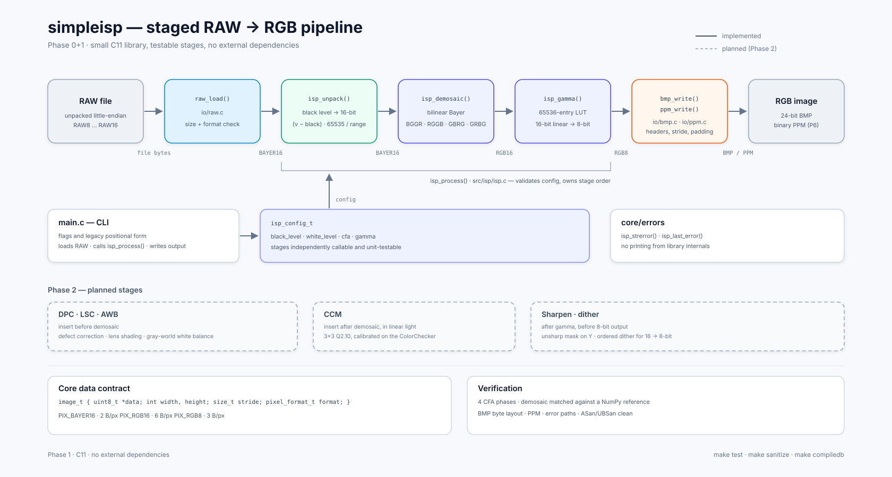

# ImageProcess — a small RAW to RGB ISP

`simpleisp` turns an unpacked Bayer RAW file into a 24-bit BMP or PPM through
a staged image signal processing pipeline written in portable C11.

```
RAW file -> unpack (black/white) -> bilinear demosaic -> gamma -> BMP/PPM
```

The stages live in separate modules behind a small `image_t` API, so AWB, CCM,
lens shading and sharpening (Phase 2) can be inserted without touching the I/O
or CLI code.  The original single-file demo is kept in [`legacy/`](legacy/) for
reference.

## Design



The diagram shows the current stages and pixel formats, the `image_t` data
contract, where `isp_config_t` enters, and the planned Phase 2 insertion
points.  Sources: [`docs/simpleisp-design.svg`](docs/simpleisp-design.svg) and
[`docs/simpleisp-design.png`](docs/simpleisp-design.png).

## Build

```sh
make            # builds ./simpleisp
make test       # builds and runs the unit tests
make sanitize   # runs the same tests under ASan + UBSan
make compiledb  # writes compile_commands.json for clangd/LSP
make clean
```

Requires a C11 compiler, `make`, and the math library (`-lm`).

`make compiledb` uses [`tools/gen-compile-commands.sh`](tools/gen-compile-commands.sh)
and needs no external tools such as `bear` or the `compiledb` package.  The
generated database contains one entry per translation unit with the same flags
as the real build, and `compile_commands.json` is gitignored.


## Usage

```sh
./simpleisp \
    --in tests/example/1280x720_RGGB_10_0.raw \
    --out test.bmp \
    --size 1280x720 \
    --format RAW10 \
    --cfa RGGB \
    --black 256 \
    --white 1023
```

| Option | Meaning |
|---|---|
| `--in <path>` | Input RAW file, unpacked little-endian samples |
| `--out <path>` | Output image; `.ppm`/`.pnm` selects PPM, anything else writes BMP |
| `--size <WxH>` | Image dimensions, e.g. `1280x720` |
| `--format <f>` | `RAW8`, `RAW10`, `RAW12`, `RAW14`, `RAW16` |
| `--cfa <p>` | Bayer phase: `BGGR`, `RGGB`, `GBRG`, `GRBG` |
| `--black <n>` | Black level in source units (default `0`) |
| `--white <n>` | Saturation level (default `2^bits - 1`) |
| `--gamma <g>` | Display gamma (default `2.2`, `0` selects linear) |
| `-h`, `--help` | Show help |

The legacy positional form is still accepted:

```sh
./simpleisp 1280 720 RAW10 RGGB input.raw output.bmp
```

`./tests/test.sh` builds the tool, runs the tests and processes both bundled
captures: `build/sample_10bit.bmp` from the 10-bit gradient and
`build/colorchecker.bmp` from the 8-bit X-Rite ColorChecker.  The script can be
run from any directory.

### Bundled sample data

| File | Format | CFA | Content |
|---|---|---|---|
| `tests/example/1280x720_RGGB_10_0.raw` | `RAW10` | `RGGB` | 1280×720 synthetic radial gradient |
| `tests/example/2564x1926_8_0.RAW` | `RAW8` | `BGGR` | 2564×1926 X-Rite ColorChecker capture |

The ColorChecker is useful for developing the Phase 2 AWB/CCM stages; the
10-bit gradient is a good unpack/gamma smoke test.

## What the pipeline does

1. **Unpack / normalise** — `(sample - black) * 65535 / (white - black)`,
   clamped, integer-only.  This replaces the old 10-bit `>> 2` truncation and
   keeps the full source range.
2. **Demosaic** — bilinear Bayer reconstruction for all four phases, ported
   from the V4L2 libv4l / libdc1394 code (itself based on OpenCV).  The port is
   RGB-ordered and 16-bit; the original BGR writes were mapped channel for
   channel and verified against an independent reference implementation.
3. **Gamma** — 16-bit linear RGB to 8-bit display RGB through a 65536-entry
   LUT.  `--gamma 0` stays linear for measurements.
4. **Output** — 24-bit BMP with manually serialised headers (no struct
   packing, no platform type assumptions) or binary PPM.

## Tests

`make test` covers:

- image allocation and overflow guards;
- black/white normalisation and clamping;
- demosaic for all four CFA phases on a uniform field (every pixel must be the
  expected RGB triple);
- gamma endpoints and rounding;
- BMP byte layout: `BFType`, `bfSize`, `bfOffBits`, field values, row padding,
  bottom-up order and BGR swapping;
- PPM header and payload;
- RAW10 little-endian loading, size mismatch and missing-file errors;
- end-to-end pipeline output;
- CFA argument parsing.

`make sanitize` runs the same suite with AddressSanitizer and
UndefinedBehaviorSanitizer enabled.

The demosaic was also compared, outside the test suite, against a NumPy
reference implementation on a 64×64 gradient: interior pixels matched
bit-exactly for `RGGB`, `BGGR`, `GBRG` and `GRBG`.

## Layout

```
src/
  core/image.c          small image container (stride-aware, format-tagged)
  core/errors.c         error codes and formatted error detail
  io/raw.c              unpacked RAW loader (RAW8..RAW16)
  io/bmp.c io/ppm.c     writers
  isp/unpack.c          black level + normalisation
  isp/demosaic.c        bilinear Bayer reconstruction
  isp/gamma.c           16 -> 8 bit LUT
  isp/isp.c             pipeline orchestration
  main.c                CLI
tests/test_isp.c        unit + end-to-end tests
tests/test.sh           builds, tests, and processes the sample captures
tests/example/          bundled RAW captures and their format notes
docs/                   design diagram (SVG + PNG)
tools/                  compile_commands.json generator
legacy/                 original demo sources and generated LUT headers
```

## Limitations

- Only unpacked (one sample per element) RAW layouts are supported; packed
  MIPI-10/12 streams are not implemented yet.
- Width and height must both be even and at least 4 pixels.
- The output is uncalibrated: there is no AWB, colour matrix, lens shading
  correction or sharpening yet, so colour casts are expected on real sensors.
- The demosaic is bilinear; edge-aware methods (Malvar-He-Cutler) are a
  Phase 2/3 improvement.
- `--white` defaults to the format's full scale.  If a capture only reaches
  767 DN (as the bundled sample does), pass `--white 767` for a full-range
  result.
- Error detail uses a process-global string; the CLI is single-threaded.

## Roadmap

- Phase 2: per-channel BLC, lens-shading mesh, gray-world AWB, 3×3 CCM,
  sharpening, `--dump-stage`, sRGB/BT.709 gamma curves.
- Phase 3: fixed-point pixel path, row-band threading, 12 MP benchmark,
  PSNR tests against simulated ground truth.

## Credits

The demosaic routines are derived from V4L2's libv4l `v4lconvert` and
libdc1394, which in turn reference OpenCV's Bayer decoding.  The original
implementation and attribution comments are preserved in
[`legacy/RAW2RGB24.c`](legacy/RAW2RGB24.c) and in `src/isp/demosaic.c`.
